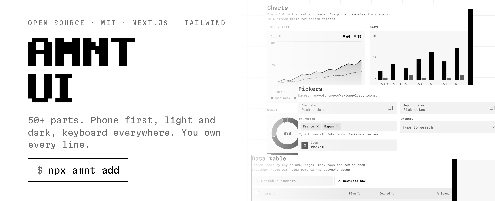
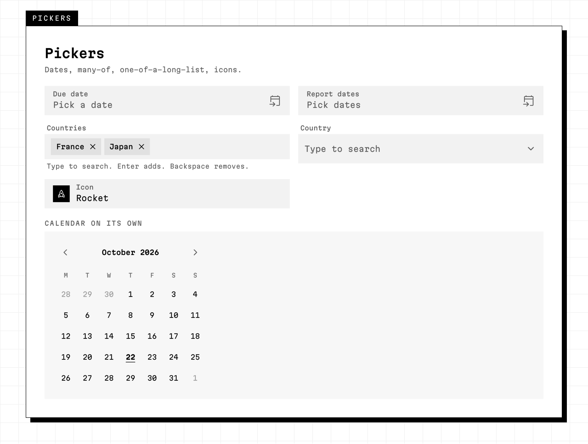
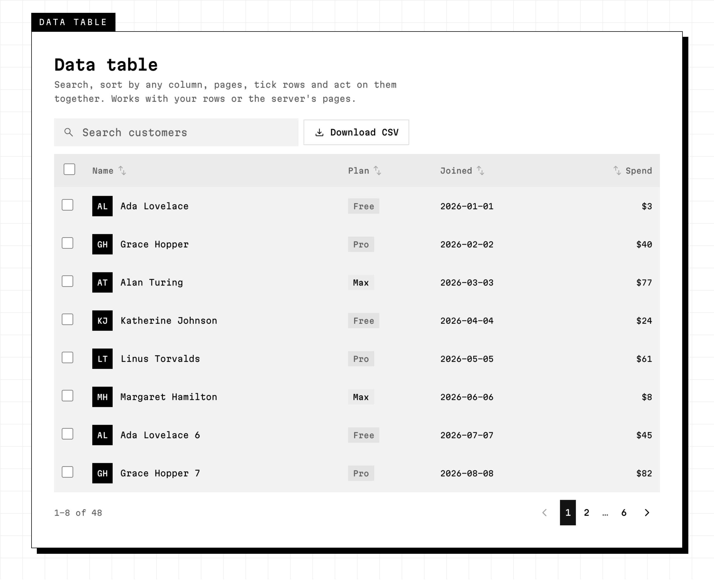
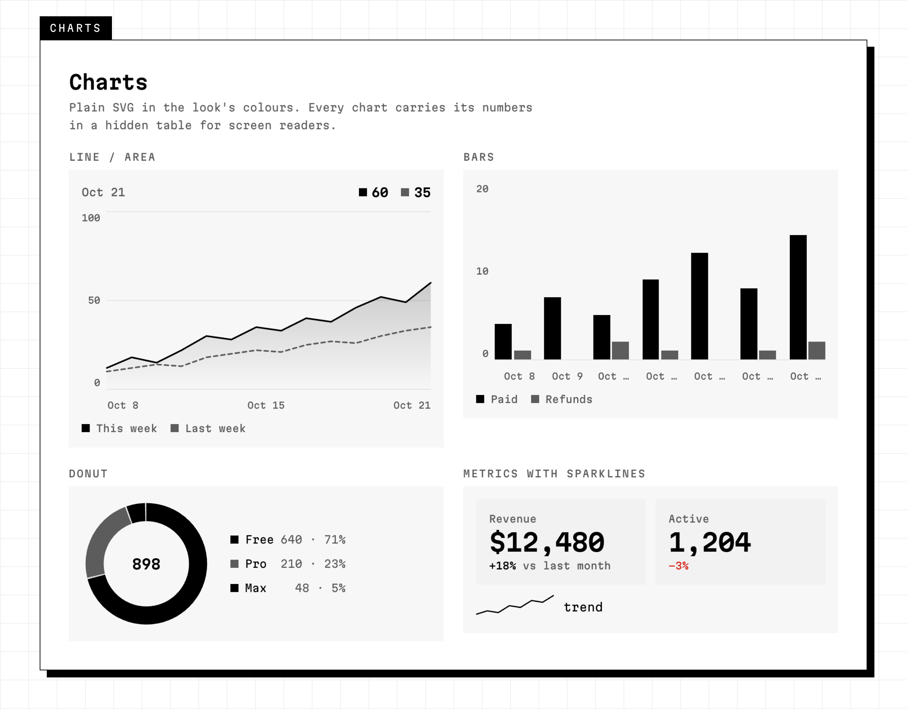
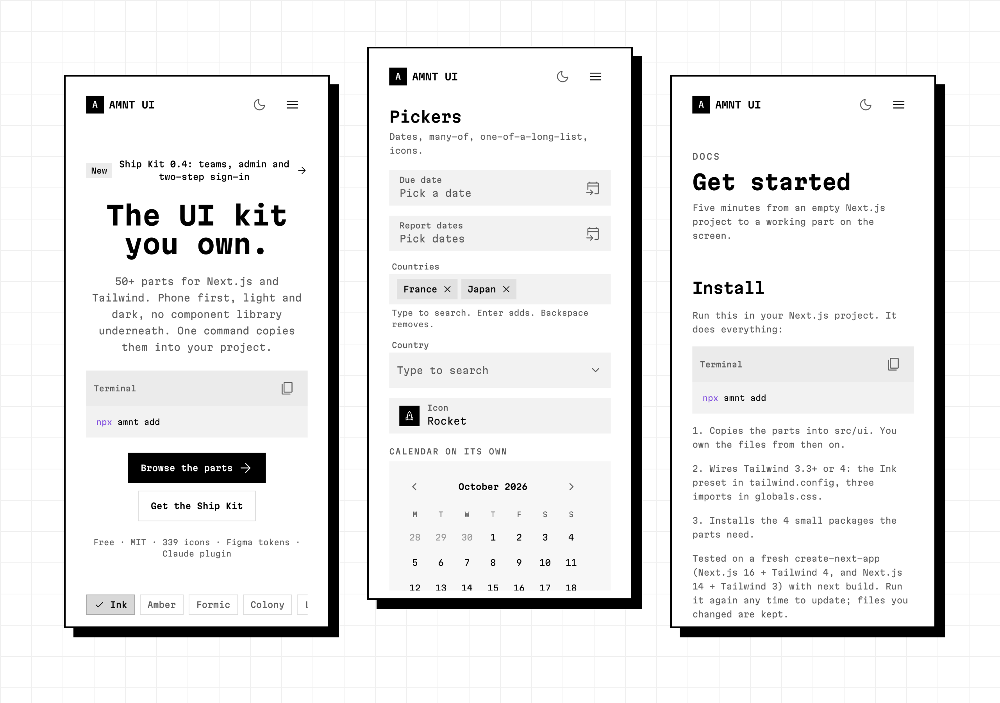

<div align="center">

<a href="https://ui.amnt.io">
  <picture>
    <source media="(prefers-color-scheme: dark)" srcset=".github/assets/banner-dark.png">
    
  </picture>
</a>

<h3>The UI kit you own.</h3>

<p>50+ parts for Next.js and Tailwind. Phone first, light and dark, keyboard everywhere.<br>
One command copies them into your project. No component library underneath.</p>

<p>
  <a href="https://ui.amnt.io/components"><b>Components</b></a> ·
  <a href="https://ui.amnt.io/docs"><b>Docs</b></a> ·
  <a href="#-install"><b>Install</b></a> ·
  <a href="https://ui.amnt.io/kit"><b>Ship Kit</b></a> ·
  <a href="CHANGELOG.md"><b>Changelog</b></a>
</p>

<p>
  <a href="LICENSE"></a>
  
  
  
  <a href="https://github.com/amntio/amnt-ui/actions/workflows/ci.yml"></a>
  <a href="https://github.com/amntio/amnt-ui/stargazers"></a>
</p>

</div>

---

## ⚡ Install

```bash
npx amnt add
```

That's the whole setup. It:

1. **Copies the parts** into `src/ui`. You own every file from then on.
2. **Wires Tailwind 3.3+ or 4**: the Ink preset and three imports in `globals.css`.
3. **Installs the 4 small packages** the parts need.

Then use them:

```tsx
import { Button, DataTable, DatePicker } from "@/ui";
import { Rocket } from "@/ui/symbols";
```

| Command | Does |
| --- | --- |
| `npx amnt add` | the whole kit |
| `npx amnt add button date-picker` | only those parts, plus the files they need |
| `npx amnt list` | every part name |

📌 Files you changed are kept. Run it again any time to update. The tool has **zero dependencies**: one readable file, [`cli/amnt.mjs`](cli/amnt.mjs).

<details>
<summary><b>Install by hand</b> (what the command does)</summary>

Copy `ui/` to `src/ui` and `tailwind.preset.ts` to `src/`. Then:

**Tailwind 4:**
1. `npm i clsx tailwind-merge@1 && npm i -D tailwindcss-animate @tailwindcss/typography`
2. `tailwind.config.mts` at the project root:
   ```ts
   import ink from "./src/tailwind.preset";
   export default { presets: [ink], content: ["./src/**/*.{ts,tsx}"] };
   ```
3. Top of `src/app/globals.css`:
   ```css
   @import "../ui/tokens/tokens.css";
   @import "../ui/tokens/legacy.css";
   @import "../ui/ui.css";
   @import "tailwindcss";
   @config "../../tailwind.config.mts";
   ```

**Tailwind 3.3+:** put `presets: [ink]` in your existing `tailwind.config`, add `"./src/ui/**/*.{ts,tsx}"` to its `content`, then add the three `@import` lines above `@tailwind base`.

`tsconfig.json` needs `"@/*": ["./src/*"]`, which Next.js sets up by default.

</details>

---

## 🧱 What's inside

<picture>
  <source media="(prefers-color-scheme: dark)" srcset=".github/assets/pickers-dark.png">
  
</picture>

| Group | Parts |
| --- | --- |
| **Buttons** | Button (filled, tonal, elevated, outlined, text, danger), IconButton, Fab, Chip, ChipGroup |
| **Inputs** | TextField, Textarea, Select, Search, Checkbox, Radio, Switch, Slider, SegmentedButton, CodeInput, ColorField, ColorPicker |
| **Pickers** | DatePicker, DateRangePicker (with quick picks), Calendar, MultiSelect, Combobox, IconPicker |
| **Upload** | FileUpload: drop, click or paste, progress per file, type and size checks |
| **Data** | DataTable (search, sort, pages, row picks, bulk actions, server mode), Table, List, Pagination |
| **Charts** | LineChart, BarChart, DonutChart, Sparkline, Metric. Plain SVG, no chart library |
| **Popups** | Menu (sub-menus, right-click), Popover, Sheet, Window, CommandMenu (⌘K), Tooltip, Toast, confirm dialog, NotificationBell |
| **Navigation** | Tabs, Breadcrumb, Steps, Accordion, NavigationBar, NavigationRail, NavigationDrawer |
| **App shells** | SidebarShell, TopbarShell, plus 6 page layouts |
| **Feedback** | Alert, Banner, EmptyState, Skeleton, Progress, Spinner, Status, Badge |
| **People** | Avatar, AvatarGroup, Person |
| **Foundations** | Colour roles (light + dark), type scale, shapes, motion, 339 icons |

<picture>
  <source media="(prefers-color-scheme: dark)" srcset=".github/assets/data-dark.png">
  
</picture>

<picture>
  <source media="(prefers-color-scheme: dark)" srcset=".github/assets/charts-dark.png">
  
</picture>

👉 **See every part working:** [ui.amnt.io/components](https://ui.amnt.io/components)

---

## 📱 Phone first

Every part is built for a 360 px screen first, then grows. Sheets slide up from the bottom on phones, shells fold to icons, and every touch target is 48 px.

<picture>
  <source media="(prefers-color-scheme: dark)" srcset=".github/assets/phones-dark.png">
  
</picture>

---

## ✅ Every part

- works with the **keyboard**
- has **screen-reader** labels
- has **48 px touch targets**
- uses **colour roles, never fixed colours**, so dark mode and your own brand colour come for free
- is **your code**: no package to upgrade, no black box

---

## 🎨 Figma

The tokens are in [`figma/`](figma), in the standard design-token format (DTCG):

| File | Holds |
| --- | --- |
| `light.tokens.json` | 49 colour roles, light |
| `dark.tokens.json` | the same roles, dark |
| `base.tokens.json` | spacing, corners, type sizes |

**Import them** with Figma's variable import (or Tokens Studio):
1. Make one collection, **Ink**, with two modes: **Light** and **Dark**.
2. Import `light.tokens.json` into Light and `dark.tokens.json` into Dark.
3. Import `base.tokens.json` into a second collection.

---

## 🤖 AI tools

**Claude Code plugin:**

```bash
claude plugin marketplace add amntio/amnt-ui
claude plugin install amnt-ui@amnt
```

Then ask: *"add a settings page with a data table and a date range picker"*. Claude knows the parts and the rules.

**Any other agent** (Cursor, Codex, Copilot, v0):
- [`AGENTS.md`](AGENTS.md): the rules every part follows, and which part to use for what.
- [`llms.txt`](llms.txt): a short map of the whole system.
- [`public/r/ink.json`](public/r/ink.json): every part in one JSON file. Tools that add components from a URL can read it.

---

## 🗂️ What's in this repo

```
ui/                  the parts (copied into your src/ui)
  components/        buttons, inputs, pickers, data, charts, popups…
  navigation/        bars, rails, drawers
  layouts/           app shells and page layouts
  tokens/            colour roles, type, shapes, motion
tailwind.preset.ts   the Ink Tailwind preset
cli/                 the `amnt` command (zero dependencies)
figma/               design tokens for Figma
fonts/               Martian Mono
plugin/              Claude Code plugin
public/r/            the parts file the CLI reads
scripts/             build the parts file, icons and Figma tokens
```

---

## 🤝 Contributing

Bug reports, ideas and pull requests are welcome. Start with [CONTRIBUTING.md](CONTRIBUTING.md).

- 🐛 [Report a bug](https://github.com/amntio/amnt-ui/issues/new?template=bug_report.yml)
- 💡 [Ask for a part](https://github.com/amntio/amnt-ui/issues/new?template=feature_request.yml)
- 🔒 Security issue? See [SECURITY.md](SECURITY.md). Please don't open a public issue.

---

## 💼 Want the whole product?

AMNT UI is the free design layer. **[AMNT Ship Kit](https://ui.amnt.io/kit)** is the paid, finished SaaS built on it. You rename it and launch. It adds sign-in and two-step sign-in, Stripe payments, teams with roles, an admin panel, six languages, 21 looks, a dashboard, landing pages, a blog, docs and legal pages.

---

## 📜 Licence

[MIT](LICENSE). Use it in anything, free or paid. Copyright © 2026 AMNT.IO LTD.

Icons: Material Symbols (Apache 2.0, Google). Font: Martian Mono (SIL OFL 1.1, Evil Martians).

<div align="center">
<br>
<sub>Built by <a href="https://amnt.io">AMNT</a> · <a href="https://ui.amnt.io">ui.amnt.io</a></sub>
</div>
